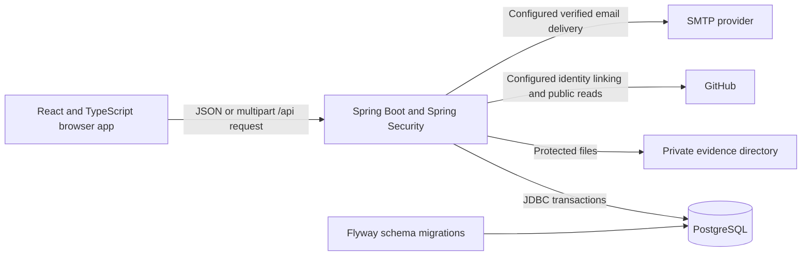

# Tracksy implementation guide

Tracksy is a workspace for student project teams and their faculty guide. It connects planned tasks to submitted evidence, review decisions, progress records and an explained contribution report. The current application uses React with TypeScript, a Spring Boot API and PostgreSQL.

This guide describes implemented behavior, the decisions behind it and the checks still needed. It is based on the accessible Tracksy GPT project review and the user's choice of the SRS stack. The older complete SRS messages/attachment still require access through the user's ChatGPT login. This document does **not** certify compliance with an unseen SRS or claim that the application has no vulnerabilities.

## Run the project

Use Node.js 24 or newer. From the project directory in a normal Windows terminal:

```shell
npm run setup
npm run dev
```

Setup obtains the workspace's Java 21, Maven and PostgreSQL tools. Initial setup and dependency installation need internet access. The tools, generated local database credentials, database files, uploads and logs live under the ignored `work/` directory. They are separate from the project source. The npm commands use the Node launcher in `scripts/local.mjs`; they do not depend on launching a PowerShell script.

Open `http://localhost:4000`. The Windows local launcher uses the explicit `demo` profile and loopback addresses. Demo accounts appear on the sign-in screen only when that profile is active. Sample accounts include `faculty@tracksy.demo`, `aarav@tracksy.demo` and `admin@tracksy.demo`; their local demo password is `TracksyDemo2026!`.

| Command | Purpose |
| --- | --- |
| `npm run setup` | Prepare the workspace tools on a fresh Windows machine. |
| `npm run dev` | Build the typed client and Java application, start the local PostgreSQL server and run the application. |
| `npm start` | Launch the application after it has been built. Use `npm run dev` for a fresh source extraction or after source changes. |
| `npm run build` | Typecheck and build the client, package the backend and run Java unit tests. |
| `npm test` | Run the build and prepared HTTP workflow checks with a separate test database/backend. This needs a terminal permitted to connect to the local database. |
| `npm run typecheck` | Check the React TypeScript source without running the app. |
| `npm run backup` | Save a local PostgreSQL dump and copy the corresponding evidence files under `work/backups/`. Stop writes or coordinate a consistent snapshot before a recovery-critical backup. |

For Docker, copy `.env.example` to `.env`, supply different strong `DB_ADMIN_PASSWORD` and `DB_PASSWORD` values, and set bootstrap faculty/admin credentials. Bootstrap passwords need at least 14 characters and no more than 72 UTF-8 bytes. Then run:

```shell
docker compose up --build
```

The compose file uses a PostgreSQL volume, a separate private upload volume and a restricted application database account. It exposes the application on `127.0.0.1:4000`. Its default profile is `production`; a sample workspace requires explicitly selecting `SPRING_PROFILES_ACTIVE=demo`. A real deployment also needs HTTPS, `COOKIE_SECURE=true`, deployment-specific allowed origins and backups. Docker configuration is included, but the Docker deployment has not been validated in this session.

## How a change reaches the database

React displays screens and submits requests. Spring checks the signed-in account, project membership, role and requested state transition. It then updates PostgreSQL inside a transaction and returns the saved result. React refreshes the relevant screen. The server makes the permission decisions even if someone bypasses the browser and calls the API directly.



The backend serves the built client and `/api` routes from the same application on port 4000. PostgreSQL stores users, persistent sessions and project records. Evidence files stay outside the publicly served frontend. Database rows identify the file and its evidence revision; downloads pass through an authorized API route.

## What the student and faculty do

1. A student proposes a project and selects a faculty guide, or the guide creates a project. A proposed project waits for faculty supervision approval.
2. The team adds people through email-bound invitations or approved join requests. A join code creates a request; it does not immediately grant access.
3. The guide or team leader assigns tasks with acceptance criteria, priority, complexity, a due date and optional milestone, parent task and dependencies.
4. The assigned student records progress and submits notes, a work link or a permitted file as evidence. Dependencies and subtasks must satisfy their completion gates first.
5. The guide approves the exact evidence version, requests changes or rejects it. Only approval completes the task. A requested revision keeps the previous submission and review visible in history.
6. Students submit weekly logs and confidential monthly peer evaluations. Faculty can review log quality and see the confidential evaluations.
7. Reports combine the published rubric with verified records. A milestone needs faculty approval after its linked tasks are verified. Project completion is also gated by the work and milestone states.

## Requirement-to-module mapping

The accessible GPT review identified the following areas. The table maps those areas to actual source modules; it does not assert that the older complete SRS has been checked line by line.

| Review requirement area | Implementation | Main source |
| --- | --- | --- |
| React + TypeScript, Spring Boot, PostgreSQL | Typed React pages and controls; Java 21 / Spring Boot 3.5.16 REST API; Spring JDBC and versioned PostgreSQL migrations | `frontend/`, `backend/pom.xml`, `backend/src/main/resources/db/migration/` |
| Authentication and account roles | Session login/logout; student-only public registration; controlled faculty/admin bootstrap; account availability checks | `AuthController`, `SecurityConfig`, `Access`, `DemoData` |
| Project creation and supervision | Student proposals, faculty acceptance/decline, project goals, technology stack, dates and lifecycle gates | `ProjectsController`, `ProjectForm` |
| Teams, invitations and leadership | Expiring email-bound invitations; join-request decisions; responsibility records; soft membership deactivation; leadership transfer | `ProjectsController`, `Team.tsx` |
| Structured task management | Assignees, priority/complexity points, subtasks, dependencies, blockers, comments and state history; cross-project/cycle checks | `TasksController`, `Tasks.tsx` |
| Evidence submission and faculty review | Protected uploads, immutable versions, exact-version review, approval/rejection/change-request states and quality ratings | `EvidenceController`, `Evidence.tsx` |
| Milestones | Due dates compatible with linked tasks; faculty completion only after current evidence and reviews approve every linked task | `WorkspaceController`, `Work.tsx` |
| Weekly progress records | One log per student/project/Monday week; own task references; retained revisions; quality reviews; stale revision rejection | `WorkspaceController`, `Work.tsx` |
| Confidential peer evaluation | One evaluation per evaluator/reviewee/current month; own submissions for students; faculty detail view; protected received aggregates | `WorkspaceController`, `Work.tsx` |
| Contribution analysis | Versioned seven-component rubric, explained numerators/denominators, completion, verified work share and separate timeliness metric | `ScoringEngine`, `ReportController`, `Reports.tsx` |
| Public GitHub integration | Configurable OAuth identity ownership; faculty selection of verified identities; bounded public repository sync; authenticated commit scoring | `GitHubIdentityController`, `RepositoryController`, `Settings.tsx` |
| Audit history and alerts | Scoped activity timeline, in-app notifications, overdue work and recorded inactivity reminders | `WorkspaceController`, `ReportController`, `AlertScheduler`, `Activity.tsx` |
| Email notifications | Optional SMTP, ownership verification, user opt-in, durable delivery state and bounded retries | `EmailNotifications`, `Settings.tsx` |
| Reports and viva preparation | Scope-protected CSV/PDF export; questions derived from current approved task evidence using templates | `ReportController`, `SimplePdf`, `Reports.tsx` |
| Account administration | Enable/disable accounts, revoke sessions, protect the last enabled admin; no blanket access to project evidence | `AdminController`, `Activity.tsx` |

## How scoring works

Task points are calculated on the server as priority points multiplied by complexity. Low/Medium/High priority gives 1/3/5 base points, and complexity ranges from 1 to 5. Scoring-relevant task fields, including the due date, are frozen after evidence exists. This prevents an assignment or deadline change from silently improving an existing assessment.

Every project stores its rubric version. Faculty can publish another version whose integer weights total 100. These are the initial implementation weights; they are a configurable assessment policy, not a claim that the inaccessible original SRS specifies these exact percentages.

| Component | Initial weight | Calculation |
| --- | ---: | --- |
| Verified tasks | 40% | Approved assigned points / all assigned points. |
| Evidence quality | 20% | Mean quality of approved current evidence / 5. Ungraded imported reviews contribute zero quality credit; historical grades are not invented. |
| Weekly consistency | 15% | Submitted eligible weekly logs / expected project weeks since joining or project start. |
| Peer evaluation | 10% | Received mean rating / 5, released for scoring only after three distinct reviewers are available. |
| Repository activity | 0% | Qualifying authenticated commits in the bounded sync / a declared target of five, capped at 100%. |
| Documentation | 10% | Faculty-reviewed log quality points / five times the expected number of weeks. |
| Milestones | 5% | Faculty-completed milestones linked to the student's work / the student's assigned milestones. |

Components stay between 0 and 100. Missing work, unavailable components and zero denominators score zero with an explanation; the server does not quietly redistribute the missing component's weight. Small teams that cannot obtain three peer reviewers should have faculty adjust the rubric rather than assume a peer score exists. Weekly denominators include the current eligible week and stop at the earliest of today, the project deadline, recorded project closure or membership deactivation. Completed/archived projects and inactive memberships therefore do not accrue more missing weeks while work is locked. Dates use the application's Asia/Kolkata calendar.

Three numbers have different meanings. Suppose you have 8 assigned points, 6 approved points and the whole project has 24 approved points. Your assigned-work completion is **75%**. Your share of verified project work is **25%**. Your rubric score also includes evidence quality, logs, peer reviews and the other published components, so it can be a different number. The UI and exports label these measures separately.

Deadline adherence is displayed separately: tasks with approved current evidence submitted by the task due date divided by all dated assigned tasks. Undated tasks are excluded, and incomplete dated tasks earn no timeliness credit. The calculation does not silently substitute task completion for timeliness.

Public repository reads work without an OAuth token, but repository assessment requires a recent successful sync and verified mappings for every active student. A scoreable commit must have a GitHub verified signature and author/committer account IDs matching the student's OAuth-owned identity, within that member's project assessment period. Commits after closure/deactivation do not add credit to that period. Repository freshness is evaluated at recorded project closure for a closed project, so a later passage of time alone does not expire that assessment. Unsigned, ambiguous and web-flow activity remains visible as activity and does not earn this component's score. Commit count measures activity, not code quality. Sync is limited to 300 default-branch commits since project start; the UI shows whether the sample was truncated.

## Security and consistency decisions

| Decision | Practical effect |
| --- | --- |
| Server permission checks | An account must be an active project member. Faculty access also requires ownership of that project. An admin role does not bypass evidence or evaluation privacy. |
| Separate leader and faculty powers | Leaders can plan/manage team tasks. Evidence, weekly logs and detailed scores remain private to the student and supervising faculty; leaders cannot approve evidence or inspect another student's assessment. |
| Persistent sessions and CSRF | JDBC-backed sessions use an HttpOnly, SameSite=Lax cookie. Mutating requests require a session CSRF token and accepted origin. Logout/disable revoke sessions; account availability is checked on API access. |
| Password handling | BCrypt stores password hashes. New passwords require at least 12 characters, with a 72-byte UTF-8 maximum. Legacy scrypt verification is retained for imports and upgraded at successful login, with a prehash strategy for compatible long legacy passwords. |
| Bound request data | JSON document/depth/string/number limits, field lengths, numeric/date checks and parameterized JDBC statements constrain malformed requests. |
| Evidence upload controls | One file up to 10 MB; PDF/PNG/JPEG/TXT/DOCX allowlist, content checks, bounded DOCX expansion and random storage names. Failed transactions remove newly written files. Downloads are authorized attachments. |
| Immutable evidence decisions | Evidence version and review uniqueness retain provenance. Expected-version checks reject stale faculty reviews and student revisions. |
| Weekly log provenance | Edits/reviews increment the revision, retain prior fields and task references, and reject stale revisions. Editing clears the quality review; late edits leave an audit event. |
| Transaction and lock ordering | Work mutations lock the project before child records, serializing lifecycle changes with work updates. Authorization is rechecked after waits. Last-admin changes lock administrator records in a stable order. |
| Consistent reports | Reports and exports use a repeatable-read database snapshot for rubric, student numerators and project denominators. Student exports include only that student's detailed result plus allowed project aggregates. |
| Confidential feedback | Student peer endpoints never return another evaluator's individual feedback or identity. Received aggregates have a minimum reviewer threshold. Private audit events are scoped to their permitted viewers. |
| Safe exports | CSV cells neutralize formula prefixes and escape delimiters. PDF export uses an embedded licensed font and pagination. Both exports include user IDs so identical display names stay distinguishable. |
| Constrained external reads | GitHub API host/identifier checks, redirect refusal, bounded response bodies, timeouts and capped pagination prevent arbitrary fetch targets. OAuth state is single-use, session-bound and expiring; tokens are not stored. |

Upload content checks are not antivirus scanning. The supplied font renders the covered scripts, including the accented Latin and Greek text exercised by the PDF unit test; unsupported glyphs fall back to `?`. CSV preserves the original UTF-8 text. Production operation needs deployment-specific hardening and measured checks; these controls are not a security certification.

## Data and source layout

`frontend/src/pages/` contains the screens, with shared components, hooks and typed API handling beside them. `backend/src/main/java/com/tracksy/` contains auth, authorization, projects, tasks and evidence. Its `workspace/` package contains logs, peer review, scoring, exports, alerts and repository analytics. Its `integrations/` package contains GitHub account linking and optional email delivery.

The database migrations are:

1. `V1__core.sql`: users, persistent sessions, projects, membership, invitations, tasks and evidence.
2. `V2__workspace.sql`: milestones, logs/history, peer reviews, rubrics, audit events, notifications and repository records.
3. `V3__github_identity.sql`: verified OAuth identities and expiring OAuth states.
4. `V4__email_delivery.sql`: verified email preferences and delivery state.
5. `V5__verified_repository_commits.sql`: commit account IDs and signature qualification.
6. `V6__assessment_cutoffs.sql`: stable project-closure and membership-deactivation timestamps for assessment periods.

Keep applied migrations unchanged; add another migration for later schema changes. V6 backfills already closed/inactive records from their previous `updated_at` values; those are the available historical timestamps, not a reconstructed transition history. Database foreign keys retain referenced history, while membership is deactivated rather than destructively removed. Back up PostgreSQL and the corresponding private upload directory together; a database-only backup cannot restore missing evidence files.

The old Express/SQLite app and its original data remain preserved in the local workspace. They are excluded from the new source archive. `scripts/migrate-legacy.mjs` prepares a transactional import into an empty, already migrated PostgreSQL target and refuses to overwrite existing users. Historical evidence decisions and password hashes are retained; missing quality grades remain ungraded. Keep a backup of the original database before applying an import.

## Verification status and remaining work

As of this local upgrade, all six migration SQL files were applied in isolated PostgreSQL standalone mode, and **19 database integrity assertions passed**. The latest completed Java suite had **20 passing tests**, covering scoring, exports, password compatibility and request validation. The final TypeScript production build and Java 21 executable build passed after the assessment cutoff changes.

`tests/workflow.test.mjs` prepares HTTP checks for login/CSRF, project isolation, invitation/join decisions, evidence state/revisions, dependencies, privacy, exports and disabled-account behavior. **Live HTTP integration and browser workflows are still pending** because the execution sandbox cannot connect the Java application to the PostgreSQL socket. Running `npm start`/`npm test` in a normal terminal is the next verification step. Standalone SQL checks do not prove HTTP authorization or UI behavior.

The older full SRS still needs retrieval and reconciliation. The review's scale targets of 5,000 users, 500 projects and 100 concurrent sessions have not been demonstrated by a measured load test. Desktop/mobile usability, backup restoration and deployment behavior need their own checks. Reports use the current rubric and current retained data: they are progress snapshots, not permanently locked certified grades. Reopening/reactivating records resumes current assessment; a policy for final academic grading and excluded pause periods still needs agreement. OAuth, public sync and SMTP need live provider configuration and verification; private GitHub repositories and an AI grading/viva service are not implemented. Viva questions are transparent evidence-derived templates. SMTP delivery has bounded retries and durable state, but SMTP cannot guarantee exactly-once delivery.

Source changes are published separately through the project's GitHub workflow. The application's repository integration only reads public activity and never pushes source code. Local databases, uploads and credentials are excluded from source commits.

### Windows PowerShell command spelling

Type `npm.cmd start` exactly to start the already built app. For a fresh source package use `npm.cmd run setup`, then `npm.cmd run dev`. The `.cmd` suffix calls the npm command supplied with Node.js without changing PowerShell execution policy. Keep the terminal open while the app runs.
